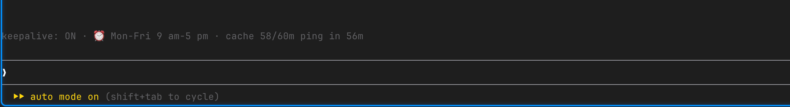
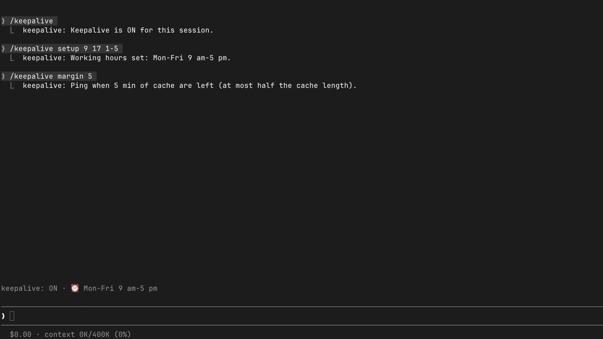
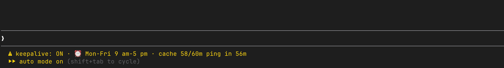

# keepalive

[](https://github.com/rolfhelder/claude-keepalive/actions/workflows/ci.yml)
[](https://github.com/rolfhelder/claude-keepalive/releases)
[](LICENSE)

Keeps an idle Claude Code session's prompt cache warm: one short ping just before the cache expires, so your next message doesn't pay to rebuild it.



## Video tutorial

[](assets/keepalive-tutorial.mp4)

56 seconds: turning it on and off, working hours with `setup`, `margin`, `view`, and `on --global`. Click the image to open the video.

## Install

Inside Claude Code:

```
/plugin marketplace add rolfhelder/claude-plugins
/plugin install keepalive@rolfhelder
```

Or from this repository alone:

```
/plugin marketplace add rolfhelder/claude-keepalive
/plugin install keepalive@keepalive
```

From a shell, the same works with `claude plugin marketplace add …` and `claude plugin install …`.

**Updates:** third-party marketplaces don't auto-update by default. Turn it on in `/plugin` → Marketplaces, or run `/plugin marketplace update`.

keepalive is **off** after install. Turn it on for this session with `/keepalive`, or for every new session with `/keepalive on --global`.

## How it works

- When a session has been idle long enough that its cache is about to expire, keepalive sends one ping ("reply ok").
- One ping per idle stretch: after a ping, nothing more is sent until you start a turn yourself.
- Only inside working hours, never while a turn is running, and never while you have a draft typed. A manual `/keepalive on` outside hours stays on until the next end of working hours.
- The cache length follows `CLAUDE_CODE_PROMPT_CACHE_TTL` / `FORCE_PROMPT_CACHING_5M` (1 h otherwise).

**Cost:** each ping is a real request and counts against your usage or bill. It's cheap next to a cold cache on a long context, but not free. On subscriptions the cache lasts 1 h by default, so that's at most one ping per idle hour.

## Commands

| Command | What it does |
| --- | --- |
| `/keepalive` | Toggle this session on or off |
| `/keepalive on` / `off` | Turn this session on or off |
| `/keepalive on --global` / `off --global` | Default for new sessions |
| `/keepalive setup <start> <end> [days]` | Working hours, e.g. `setup 8 18 1-5`, or `setup 0 24 0-6` for always; days 0 = Sun |
| `/keepalive margin <min>` | Ping when this many minutes of cache are left (1–59, at most half the cache length) |
| `/keepalive view` | Move the line between the row above the prompt and the status line |

Anything else after `/keepalive` is handed to Claude with the command's help, so plain requests work too.

## Configuration

| Setting | Default | Meaning |
| --- | --- | --- |
| `placement` | `above-prompt` | `above-prompt`: a fixed row above the input. `status-line`: an entry in the status line, which can swap places with other plugins' entries as they update. `/keepalive view` toggles it. |

Working hours, margin and the global default are stored by the plugin and set with the commands above. Defaults: off, Mon–Fri 9 am–5 pm, 2-minute margin, no ping cap beyond one per idle stretch.



## Privacy

keepalive sends nothing anywhere except the ping itself, as an ordinary turn in your own session. It stores only its settings and each session's on/off state, in Claude Code's plugin storage on your machine.

## Policy note

Automatically pinging a model to keep a cache warm is a grey area. That's why keepalive is off by default and sends at most one ping per idle stretch. Whether to turn it on, and making sure it fits the terms of your account, is your call.

## Troubleshooting

- **No ping arrives:** check the line says `ON`, that you're inside working hours, and that the session has been idle until `ping in 0m`. A typed draft postpones the ping.
- **The line is missing:** run `/reload-plugins`; check `/plugin` shows keepalive enabled.
- **Something else:** run `claude --debug` and look for lines starting with `keepalive:`, then open an issue (see below).

## Uninstall

```
/plugin uninstall keepalive@rolfhelder
```

(or `keepalive@keepalive` if you installed from this repository). Nothing is left running.

## Contributing and security

Bug reports, ideas and pull requests: see [CONTRIBUTING.md](CONTRIBUTING.md). Security issues: see [SECURITY.md](SECURITY.md). Changes are listed in [CHANGELOG.md](CHANGELOG.md).

## License

[MIT](LICENSE)
